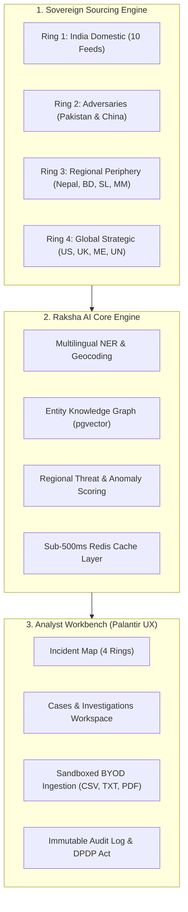

# RAKSHA AI — Sovereign Defence OSINT Platform
## iDEX / DISC Proposal & Capability Pitch Deck
**Classification:** PUBLIC // OPEN SOURCE INTELLIGENCE BENCHMARK  
**Target Authority:** Ministry of Defence (MoD) / Defence Innovation Organisation (DIO) / iDEX  
**Platform Owner:** Jay (Platform & Engineering Lead)  
**System Status:** Stage 3 Solid Build (Fully Integrated)

---

### Executive Summary

India faces a complex, multi-domain security landscape characterized by 2-front contested borders (LAC & LoC), maritime choke-points in the Indian Ocean Region (IOR), and state-sponsored gray-zone information operations. 

**Raksha AI** is an indigenous, sovereign Open-Source Intelligence (OSINT) analyst platform designed to give Indian defence intelligence analysts an unfair informational advantage. Built on the design principles of Palantir Gotham and Foundry, Raksha AI aggregates multilingual border reports, resolves covert entities and front organizations, computes regional threat indices, tracks event timelines, and manages investigations with zero hallucination attribution.

---

### Key Capabilities Matrix



---

### 1. The 4 Security Rings Model

Intelligence collection adheres strictly to a geopolitical ring architecture:
- **Ring 1 (India Domestic):** PIB, ANI, The Hindu, Indian Express, MP-IDSA, Bharat Shakti, Swarajya.
- **Ring 2 (Adversaries):** Dawn, Express Tribune, ISPR, Global Times, Xinhua, PLA Daily.
- **Ring 3 (Regional Periphery):** Daily Mirror (SL), Kathmandu Post (NP), Dhaka Tribune (BD), The Irrawaddy (MM).
- **Ring 4 (Global Strategic):** Reuters, BBC, Al Jazeera, US DoD, Institute for the Study of War (ISW).

---

### 2. Core Technological Innovations (Stage 1 to Stage 3)

| Milestone | Capability | Defence & Intelligence Advantage |
|:---|:---|:---|
| **M1–M3 (MVP)** | 40 Monitored Feeds & Ingestion | Automated ingestion across 4 rings; deduplication and multi-lingual ingestion. |
| **M4–M7 (Stage 2)** | Knowledge Graph & Threat Scoring | 1-hop and 2-hop entity network traversal; 1–10 regional threat score tracking. |
| **M8 (Stage 3 Solid)** | RBAC, Workspaces & Immutable Audit | Military-grade JWT auth (`admin`, `analyst`, `viewer`); tamper-proof append-only `audit_log`. |
| **M9b (Stage 3 Solid)** | Cases & Dossier Workspace | Evidence pinning (`articles`, `entities`, `events`), hypothesis logs, automated case dossier export. |
| **M9c (Stage 3 Solid)** | Sandboxed BYOD Data Ingestion | Safe upload for field CSV/TXT/PDF logs; magic bytes validation; 15MB/50-page limits; workspace isolation. |
| **M9c (Stage 3 Solid)** | DPDP Act Correction Workflow | Rights-grounded challenge and takedown mechanism with full lineage verification. |
| **M10 (Stage 3 Solid)** | Observability & Celery Queue | Prometheus `/metrics` endpoint; Celery background workers; Sentry error tracing. |
| **M11 (Stage 3 Solid)** | Production Deployment | Docker Compose (`docker-compose.prod.yml`), Nginx reverse proxy, CI/CD automated pipeline. |

---

### 3. Defence Rigour & Compliance Guarantees

1. **Strictly Public OSINT:** All intelligence is extracted solely from open-source feeds, press releases, and syndication. Zero classified intelligence is ingested.
2. **Zero Attribution Hallucination:** No synthetic labels or unsourced statements are assigned. Every fact links directly to its source wire citation (`[title, source, published_at]`).
3. **Air-Gapped Sandboxing for Custom Data:**
   - Files stored strictly outside web root (`data/uploads/sandboxed/`).
   - Magic byte header inspection rejects executable binaries (PE, ELF, ZIP, Scripts).
   - Tagged `source_type='user_upload'` and isolated to private workspace. Excluded from public threat scoring unless formally promoted.
4. **Digital Personal Data Protection (DPDP) Act Compliance:**
   - Formal correction and takedown request API (`/api/corrections`).
   - Citizens and analysts can lodge challenges against entity profiles or extracted claims.
   - Comprehensive audit tracking ensures complete compliance records.

---

### 4. Technical Architecture Specifications

- **Frontend:** Next.js 14 (App Router), TypeScript, Tailwind CSS, Lucide Icons, Leaflet / OpenStreetMap.
- **Backend API:** FastAPI (Python 3.11+), Pydantic v2, Gunicorn / Uvicorn workers.
- **Database:** PostgreSQL 15 with `pgvector` extension for semantic embedding searches.
- **Caching & Broker:** Redis 7 (in-memory caching for `<500ms` response times, Celery task broker).
- **Asynchronous Engine:** Celery 5.7+ with multi-worker concurrency and soft/hard timeouts.
- **Reverse Proxy & Security:** Nginx 1.25 Alpine with SSL, strict CSP, and rate limiting.
- **Observability:** Prometheus metric scrapers (`raksha_http_requests_total`, `raksha_http_request_duration_seconds`, `raksha_ingestion_articles_total`, `raksha_theatre_threat_score`).

---

### 5. iDEX Deployment Roadmap

```
Phase 1: Lab Validation & Prototype Demonstration (Completed)
  ├── 40 Feeds across 4 Rings active
  ├── 100% Type-Safe Frontend (Zero TypeScript compilation errors)
  └── 24+ Automated Backend Integration Tests Passing

Phase 2: Closed Sandbox Trial with Military Analysts (Next 60 Days)
  ├── Field testing of Cases Workspace with active military OSINT teams
  ├── Integration with internal secure LAN networks
  └── Deployment of on-prem air-gapped Docker instances

Phase 3: Full Operational Capability (FOC - 120 Days)
  ├── Multi-lingual translation pipeline (Mandarin / Urdu audio/video OCR)
  ├── Edge deployment on ruggedized field terminals
  └── Tri-service intelligence sharing with role-based partitioned workspaces
```

---
*Developed with sovereign engineering precision for India's national security ecosystem.*
